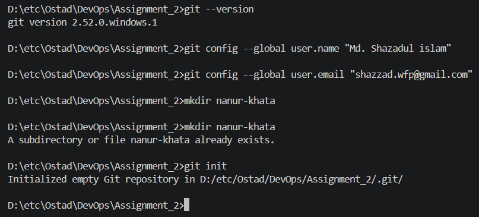
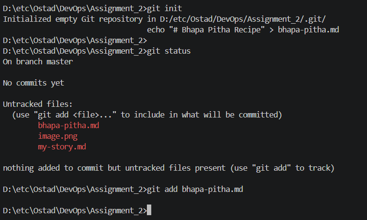
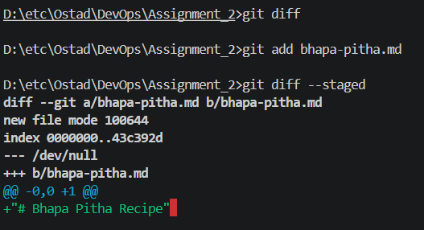
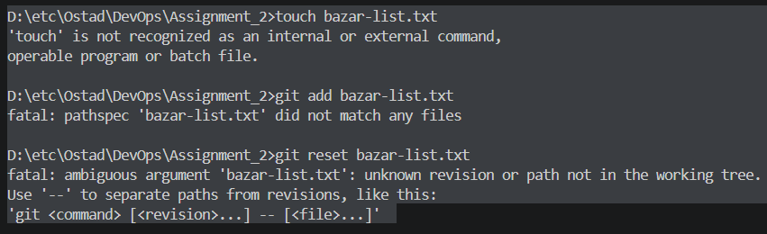
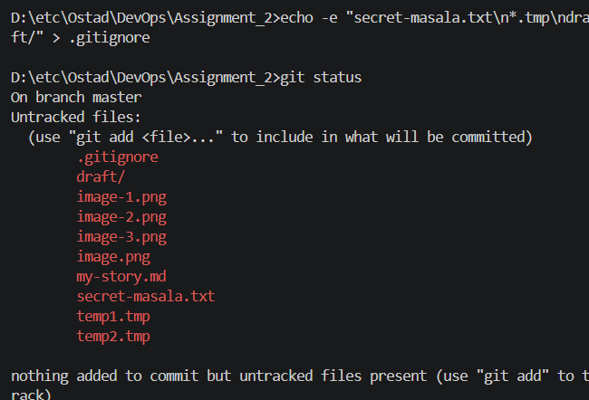
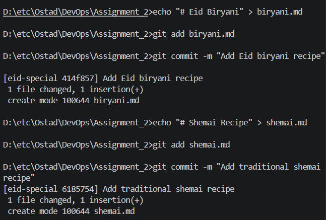
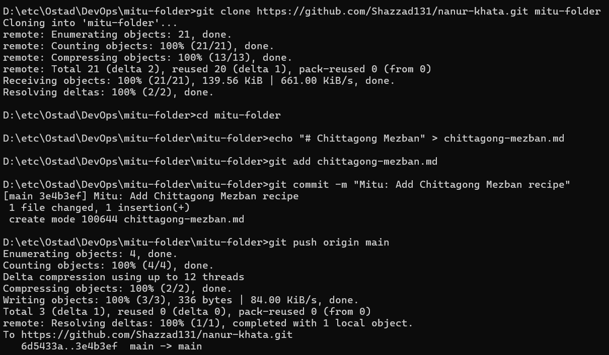
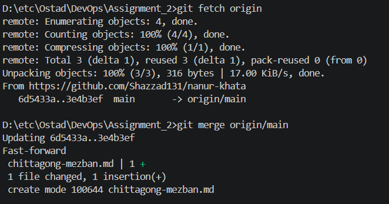
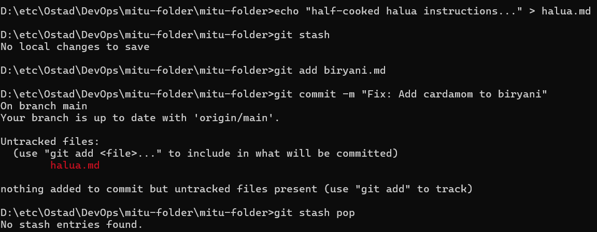
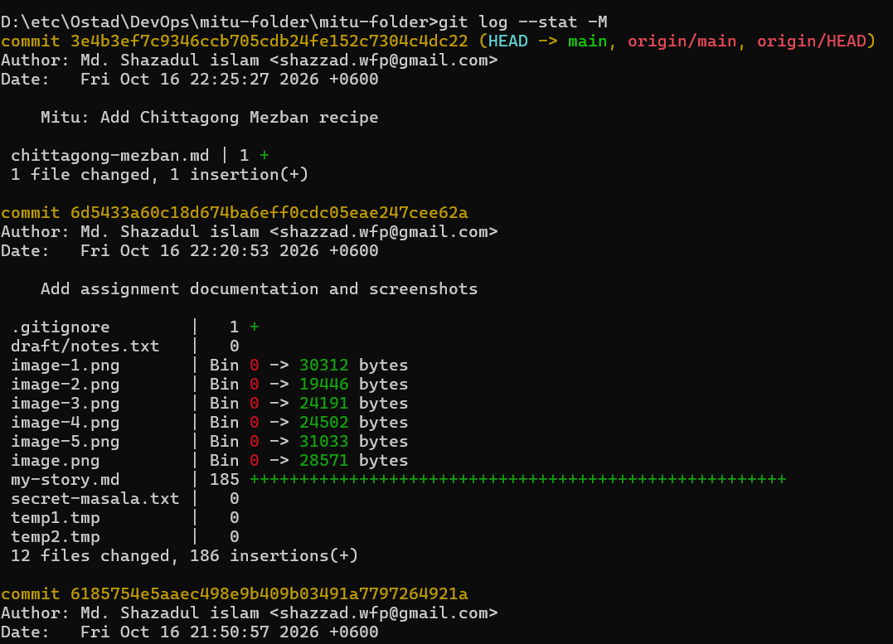

## Chapter 1: The First Recipe (20 Marks)
Nanu says: "Winter is coming. Write the bhapa pitha recipe first."

Task A: Set up Git identity and create your repository folder.

D:\etc\Ostad\DevOps\Assignment_2>git --version
git version 2.52.0.windows.1

D:\etc\Ostad\DevOps\Assignment_2>git config --global user.name "Md. Shazadul islam" 

D:\etc\Ostad\DevOps\Assignment_2>git config --global user.email "shazzad.wfp@gmail.com" 

D:\etc\Ostad\DevOps\Assignment_2>mkdir nanur-khata

D:\etc\Ostad\DevOps\Assignment_2>mkdir nanur-khata
A subdirectory or file nanur-khata already exists.

D:\etc\Ostad\DevOps\Assignment_2>git init
Initialized empty Git repository in D:/etc/Ostad/DevOps/Assignment_2/.git/

### Task B: Create the first recipe file, check status, and stage it.

D:\etc\Ostad\DevOps\Assignment_2>git init
Initialized empty Git repository in D:/etc/Ostad/DevOps/Assignment_2/.git/
                                 echo "# Bhapa Pitha Recipe" > bhapa-pitha.md
D:\etc\Ostad\DevOps\Assignment_2>
D:\etc\Ostad\DevOps\Assignment_2>git status
On branch master

No commits yet

Untracked files:
  (use "git add <file>..." to include in what will be committed)
        bhapa-pitha.md
        image.png
        my-story.md

nothing added to commit but untracked files present (use "git add" to track)

D:\etc\Ostad\DevOps\Assignment_2>git add bhapa-pitha.md

D:\etc\Ostad\DevOps\Assignment_2>

### Task C: Modify the file and practice git diff

"One and a half cups of gur, not two!"

D:\etc\Ostad\DevOps\Assignment_2>git diff --staged     
diff --git a/bhapa-pitha.md b/bhapa-pitha.md
new file mode 100644
index 0000000..43c392d
--- /dev/null
+++ b/bhapa-pitha.md
@@ -0,0 +1 @@
+"# Bhapa Pitha Recipe" 

### Task D: Commit your changes.

D:\etc\Ostad\DevOps\Assignment_2>git commit -m "Add initial bhapa pitha recipe with corrected gur amount"
[master (root-commit) 0def227] Add initial bhapa pitha recipe with corrected gur amount
 1 file changed, 1 insertion(+)
 create mode 100644 bhapa-pitha.md

 ### Task E: Practice unstaging a file.
 

 D:\etc\Ostad\DevOps\Assignment_2>touch bazar-list.txt
'touch' is not recognized as an internal or external command,
operable program or batch file.

D:\etc\Ostad\DevOps\Assignment_2>git add bazar-list.txt
fatal: pathspec 'bazar-list.txt' did not match any files

D:\etc\Ostad\DevOps\Assignment_2>git reset bazar-list.txt
fatal: ambiguous argument 'bazar-list.txt': unknown revision or path not in the working tree.
Use '--' to separate paths from revisions, like this:
'git <command> [<revision>...] -- [<file>...]'

## Chapter 2: The Secret Spice (10 Marks)
### Nanu's secret spice blend must never reach GitHub.
  

Task A & B: Prevent secret files from being tracked.

D:\etc\Ostad\DevOps\Assignment_2>echo -e "secret-masala.txt\n*.tmp\ndraft/" > .gitignore

D:\etc\Ostad\DevOps\Assignment_2>git status
On branch master
Untracked files:
  (use "git add <file>..." to include in what will be committed)
        .gitignore
        draft/
        image-1.png
        image-2.png
        image-3.png
        image.png
        my-story.md
        secret-masala.txt
        temp1.tmp
        temp2.tmp

nothing added to commit but untracked files present (use "git add" to track)

## Chapter 3: The Eid Special (20 Marks)
### we want to test the Eid recipes without touching the main book.

### Task A: Create and switch to a new branch.

D:\etc\Ostad\DevOps\Assignment_2>git checkout -b eid-special
Switched to a new branch 'eid-special'

### Task B: Add two recipes in separate commits.

D:\etc\Ostad\DevOps\Assignment_2>echo "# Eid Biryani" > biryani.md

D:\etc\Ostad\DevOps\Assignment_2>git add biryani.md

D:\etc\Ostad\DevOps\Assignment_2>git commit -m "Add Eid biryani recipe" 
[eid-special 414f857] Add Eid biryani recipe
 1 file changed, 1 insertion(+)
 create mode 100644 biryani.md

D:\etc\Ostad\DevOps\Assignment_2>echo "# Shemai Recipe" > shemai.md

D:\etc\Ostad\DevOps\Assignment_2>git add shemai.md

D:\etc\Ostad\DevOps\Assignment_2>git commit -m "Add traditional shemai recipe"
[eid-special 6185754] Add traditional shemai recipe
 1 file changed, 1 insertion(+)
 create mode 100644 shemai.md

 ### Task C: Merge back to main.

 D:\etc\Ostad\DevOps\Assignment_2>git checkout master
Switched to branch 'master'

D:\etc\Ostad\DevOps\Assignment_2>git merge eid-special
Updating 0def227..6185754
Fast-forward
 biryani.md | 1 +
 shemai.md  | 1 +
 2 files changed, 2 insertions(+)
 create mode 100644 biryani.md
 create mode 100644 shemai.md

D:\etc\Ostad\DevOps\Assignment_2>git log --oneline
6185754 (HEAD -> master, eid-special) Add traditional shemai recipe
414f857 Add Eid biryani recipe
0def227 Add initial bhapa pitha recipe with corrected gur amount

## Chapter 4: Mitu Joins In (20 Marks)
### Mitu wants to write in the book too, all the way from Chattogram.

D:\etc\Ostad\DevOps\Assignment_2>git remote add origin https://github.com/Shazzad131/nanur-khata

D:\etc\Ostad\DevOps\Assignment_2>git branch -M main

D:\etc\Ostad\DevOps\Assignment_2>git push -u origin main
Enumerating objects: 9, done.
Counting objects: 100% (9/9), done.
Delta compression using up to 12 threads
Compressing objects: 100% (5/5), done.
Writing objects: 100% (9/9), 815 bytes | 90.00 KiB/s, done.
Total 9 (delta 1), reused 0 (delta 0), pack-reused 0 (from 0)
remote: Resolving deltas: 100% (1/1), done.
To https://github.com/Shazzad131/nanur-khata
 * [new branch]      main -> main

 ### Task B: Simulate Mitu.

 

D:\etc\Ostad\DevOps\mitu-folder>git clone https://github.com/Shazzad131/nanur-khata.git mitu-folder
Cloning into 'mitu-folder'...
remote: Enumerating objects: 21, done.
remote: Counting objects: 100% (21/21), done.
remote: Compressing objects: 100% (13/13), done.
remote: Total 21 (delta 2), reused 20 (delta 1), pack-reused 0 (from 0)
Receiving objects: 100% (21/21), 139.56 KiB | 661.00 KiB/s, done.
Resolving deltas: 100% (2/2), done.

D:\etc\Ostad\DevOps\mitu-folder>cd mitu-folder

D:\etc\Ostad\DevOps\mitu-folder\mitu-folder>echo "# Chittagong Mezban" > chittagong-mezban.md

D:\etc\Ostad\DevOps\mitu-folder\mitu-folder>git add chittagong-mezban.md

D:\etc\Ostad\DevOps\mitu-folder\mitu-folder>git commit -m "Mitu: Add Chittagong Mezban recipe"
[main 3e4b3ef] Mitu: Add Chittagong Mezban recipe
 1 file changed, 1 insertion(+)
 create mode 100644 chittagong-mezban.md

D:\etc\Ostad\DevOps\mitu-folder\mitu-folder>git push origin main
Enumerating objects: 4, done.
Counting objects: 100% (4/4), done.
Delta compression using up to 12 threads
Compressing objects: 100% (2/2), done.
Writing objects: 100% (3/3), 336 bytes | 84.00 KiB/s, done.
Total 3 (delta 1), reused 0 (delta 0), pack-reused 0 (from 0)
remote: Resolving deltas: 100% (1/1), completed with 1 local object.
To https://github.com/Shazzad131/nanur-khata.git
   6d5433a..3e4b3ef  main -> main

 ### Task C & D: Fetch, Merge vs Pull.
 
 D:\etc\Ostad\DevOps\Assignment_2>git fetch origin
remote: Enumerating objects: 4, done.
remote: Counting objects: 100% (4/4), done.
remote: Compressing objects: 100% (1/1), done.
remote: Total 3 (delta 1), reused 3 (delta 1), pack-reused 0 (from 0)
Unpacking objects: 100% (3/3), 316 bytes | 17.00 KiB/s, done.
From https://github.com/Shazzad131/nanur-khata
   6d5433a..3e4b3ef  main       -> origin/main

D:\etc\Ostad\DevOps\Assignment_2>git merge origin/main
Updating 6d5433a..3e4b3ef
Fast-forward
 chittagong-mezban.md | 1 +
 1 file changed, 1 insertion(+)
 create mode 100644 chittagong-mezban.md

 D:\etc\Ostad\DevOps\mitu-folder\mitu-folder>git pull origin main
From https://github.com/Shazzad131/nanur-khata
 * branch            main       -> FETCH_HEAD
Already up to date.

### Question: What is the difference between fetch + merge and pull?
ANS: git fetch downloads the latest changes from the remote repository without integrating/changing your current working files, whereas git pull is a shortcut that automatically runs git fetch followed by git merge to integrate the changes immediately.

## Chapter 5  Half-Cooked Halua and Time Travel
### Task A  Save the halua work with git stash, fix and commit the biryani, then git stash pop.

D:\etc\Ostad\DevOps\mitu-folder\mitu-folder>echo "half-cooked halua instructions..." > halua.md

D:\etc\Ostad\DevOps\mitu-folder\mitu-folder>git stash
No local changes to save

D:\etc\Ostad\DevOps\mitu-folder\mitu-folder>git add biryani.md

D:\etc\Ostad\DevOps\mitu-folder\mitu-folder>git commit -m "Fix: Add cardamom to biryani"
On branch main
Your branch is up to date with 'origin/main'.

Untracked files:
  (use "git add <file>..." to include in what will be committed)
        halua.md

nothing added to commit but untracked files present (use "git add" to track)

D:\etc\Ostad\DevOps\mitu-folder\mitu-folder>git stash pop
No stash entries found.

### Task B: Moving and deleting files

### Task C & D: Time travel & inspecting commits

D:\etc\Ostad\DevOps\mitu-folder\mitu-folder>git log --oneline
3e4b3ef (HEAD -> main, origin/main, origin/HEAD) Mitu: Add Chittagong Mezban recipe
6d5433a Add assignment documentation and screenshots
6185754 Add traditional shemai recipe
414f857 Add Eid biryani recipe
0def227 Add initial bhapa pitha recipe with corrected gur amount

D:\etc\Ostad\DevOps\mitu-folder\mitu-folder>git show <commit-SHA>
The syntax of the command is incorrect.

D:\etc\Ostad\DevOps\mitu-folder\mitu-folder>git show 414f857
commit 414f857301a2e7ef0ad901f9b22a4adaa4e651a7
Author: Md. Shazadul islam <shazzad.wfp@gmail.com>
Date:   Fri Oct 16 21:50:20 2026 +0600

    Add Eid biryani recipe

diff --git a/biryani.md b/biryani.md
new file mode 100644
index 0000000..4cf3725
--- /dev/null
+++ b/biryani.md
@@ -0,0 +1 @@
+"# Eid Biryani"

Answer: rebase and reset --hard rewrite history. On shared branches (like main), doing this disrupts your collaborators because their local histories will diverge violently from the remote branch history, causing severe sync issues.

D:\etc\Ostad\DevOps\Assignment_2>git log --oneline --graph --all
* 3e4b3ef (HEAD -> main, origin/main, origin/HEAD) Mitu: Add Chittagong Mezban recipe
* 6d5433a Add assignment documentation and screenshots
* 6185754 (eid-special) Add traditional shemai recipe
* 414f857 Add Eid biryani recipe
* 0def227 Add initial bhapa pitha recipe with corrected gur amount
